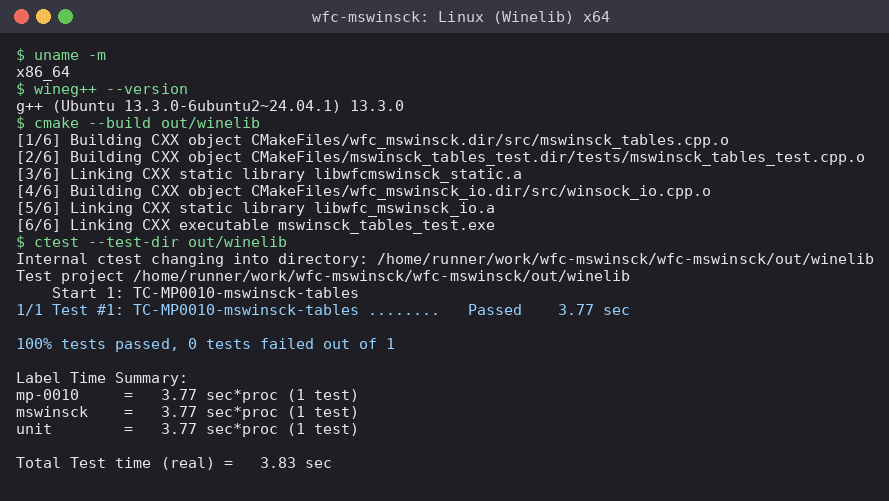
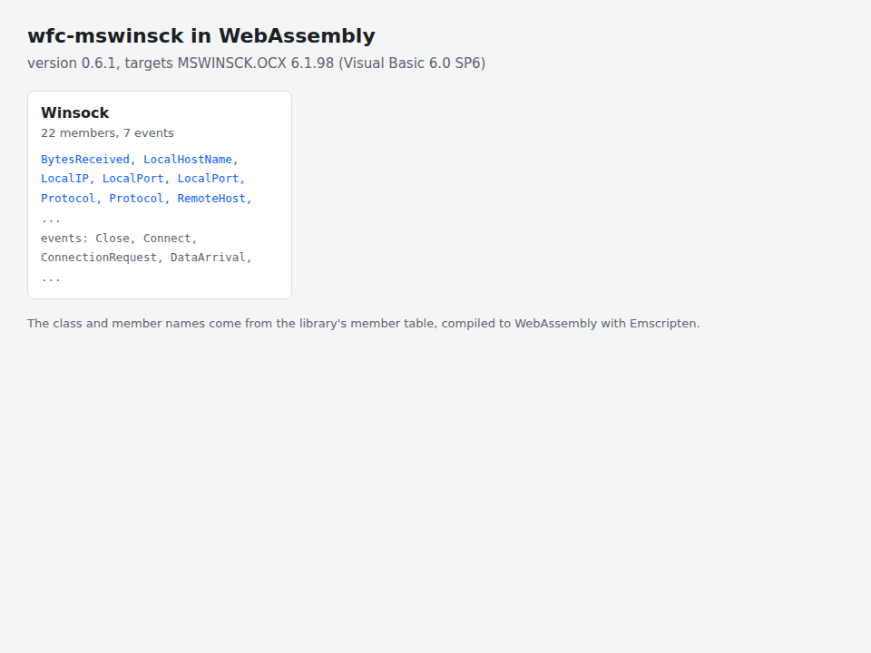

# wfc-mswinsck

Winsock for WFC: the native replacement for `mswinsck.ocx` (library MSWinsockLib).

- `src/mswinsck_tables.cpp` the member table of the control.
- `src/winsock_io.cpp` the non-blocking socket layer; it stays in the program
  (target `wfc_mswinsck_io`), not in the DLL.
- `include/wfc/mswinsck/mswinsck.hpp` the accessor `wfc::ui::mswinsck_classes()`.
- `include/wfc/mswinsck/mswinsck.inc` the behaviour of the control: the
  properties, methods and events, compiled into the WFC evaluator, which
  includes it (`src/interpreter/forms.cpp`). It uses the evaluator's internal
  types, so it builds only inside WFC.
- `include/wfc/ocx/control_class.hpp` the table types, identical in every WFC
  control library (a WFC test checks the copies).
- `VERSION` the library version, stamped into `wfcmswinsck.dll`.

Target: `wfc_mswinsck` (static library, or `wfcmswinsck.dll` with `WFC_MSWINSCK_SHARED=ON`;
the parent default is `WFC_OCX_SHARED`).

## Screenshots


The Winsock echo example (`examples/winsock-echo`): a server and a client on the loopback address. Run it with [WFC](https://github.com/Thewafflication/wfc):

```
wfc run examples/winsock-echo/echo.vbp --gui
```

The images are made with `wfc run ... --gui --screenshots <dir>`.

### Linux (Winelib)



The CI session on Linux x64: the library is built with Wine's `wineg++` and its
test runs. The same session for [x86](docs/images/linux-winelib-x86.png) and
[arm64](docs/images/linux-winelib-arm64.png) (arm64 builds only; Wine hangs
there). These images are rendered from the real CI output by
`scripts/render_terminal.py`.

### WebAssembly



The member table compiled to WebAssembly and listed by a page
(`web/index.html`), captured in Chromium by `scripts/capture_web.py` in CI.

## Roadmap, compatibility and platforms

- [ROADMAP.md](ROADMAP.md): milestones from 0.6.x to Microsoft parity,
  including the platform and toolchain tracks.
- [COMPATIBILITY.md](COMPATIBILITY.md): how far the library matches the
  Microsoft component.
- [docs/WSP-ADOPTION.md](docs/WSP-ADOPTION.md): the WSP baseline the library
  follows (`wsp/` submodule).

| Platform | Status |
| --- | --- |
| Windows x86, x64, ARM64 (MSVC) | CI workflow in place; first run pending |
| Linux x86, x64, ARM through Winelib | x64 and x86 build and test in CI; arm64 builds only (Wine hangs there); `cmake/winelib.cmake` |
| WebAssembly (Emscripten) | experimental CI job (member table) |
| WFC's own C++ compiler and library | planned; neither exists yet |

## Building on its own

```
git clone --recurse-submodules https://github.com/Thewafflication/wfc-mswinsck
cmake -S wfc-mswinsck -B out/build
cmake --build out/build --config Debug
ctest --test-dir out/build -C Debug
```

Under Winelib: `-DCMAKE_TOOLCHAIN_FILE=cmake/winelib.cmake
-DWFC_WARNINGS_AS_ERRORS=OFF`. For WebAssembly use `emcmake cmake`.

## Version and target

The version is in `VERSION` and the Microsoft component it stands in for in
`TARGET`: **mswinsck** targets MSWINSCK.OCX 6.1.98 (Visual Basic 6.0 SP6). The version stays
`0.<target major>.<target minor>` until the library matches the Microsoft one
functionally; then it takes the Microsoft version. Both are stamped into the
DLL's version resource (`FileVersion`, `Comments`).

## Registration with Windows

`regsvr32 wfcmswinsck.dll` (`/u` to remove) writes `Software\WFC\Libraries\mswinsck`
(version, target, path) and, for every control, a class under WFC's own ProgID and class id (`WFC.<Library>.<Class>`) with the DLL as in-process server. `WFC_REGISTER_SCOPE=user|machine` picks the registry
(default: the machine, the user when that is not writable). With `WFC_REGISTER_MICROSOFT_IDS=1` the controls are also served under the Microsoft ProgIDs and class ids; what was registered there before is saved and restored by `regsvr32 /u`. `DllGetClassObject` returns a class factory whose objects are late-bound (IDispatch) controls built from the member table: a property keeps the value it is given and a method is accepted, with no WFC evaluator; the behaviour of the controls is still implemented by the evaluator of WFC.

Each library is also a WPM package of its own (`wfc-mswinsck`), whose install script
copies the DLL to `lib\wfcmswinsck\<version>\<arch>` of the WFC installation and
registers it, so dynamically linked programs get an update by installing that
package alone.

Part of [WFC](https://github.com/Thewafflication/wfc), where it is mounted at
`lib/wfc-mswinsck`. Licence: GPL-3.0-or-later (see the WFC `LICENSE`).
